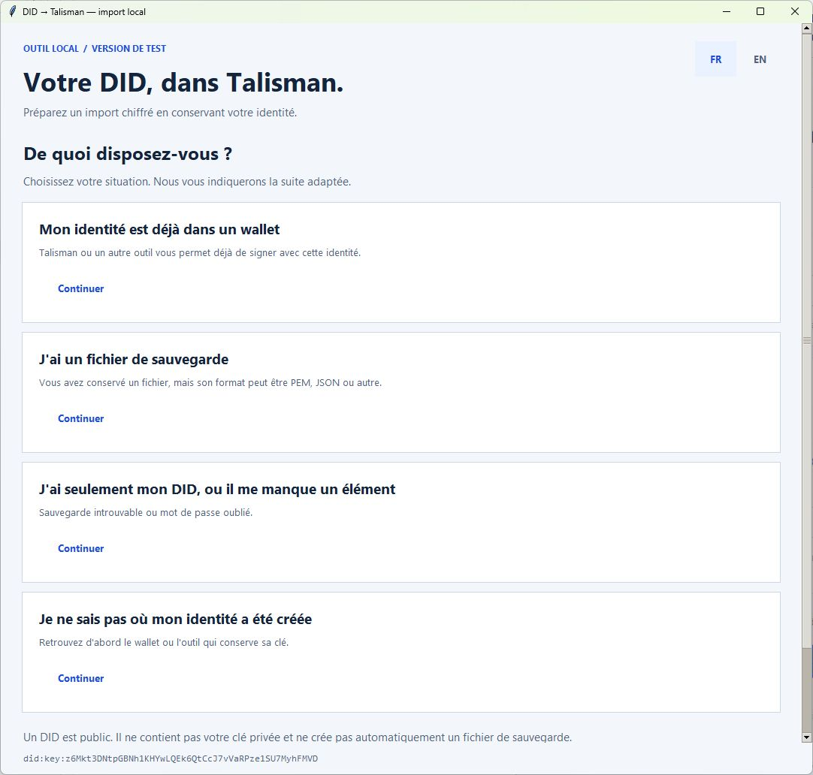

# DID → Talisman

**Version de test publique 0.2.0 — Windows · Français / English.**

[Télécharger le ZIP](https://github.com/AMCONSEIL/did-to-talisman/archive/refs/heads/main.zip) · [Signaler un problème](https://github.com/AMCONSEIL/did-to-talisman/issues)

**Conservez votre DID existant et préparez son import dans Talisman, localement.**

[English](README.md) · [Tutoriel complet](TUTORIEL.fr.md) · [Auteur et attribution](IDENTITY.md)

L'outil transforme votre **PEM Ed25519 chiffré** en un **JSON Polkadot v3 chiffré** importable dans Talisman. Il compare la clé au DID que vous renseignez, restaure l'export et vérifie une signature avant de confirmer sa réussite.

Avant d’installer : si votre identité est déjà utilisable dans un wallet, ou si vous avez un JSON de wallet compatible, consultez le [choix du parcours](TUTORIEL.fr.md#1-choisir-son-parcours-sans-supposer-un-format). La conversion PEM peut être inutile.

## Démarrer sous Windows

1. Installer [Python 3.11+ avec Tcl/Tk](https://www.python.org/downloads/windows/) et [Node.js 22+](https://nodejs.org/en/download).
2. Extraire le dossier complet, puis lancer **INSTALLER_WINDOWS.cmd**. Cette installation télécharge les dépendances publiques verrouillées ; elle ne lit aucun wallet.
3. Lancer **LANCER.cmd**. Choisir sa situation dans le guide. Le formulaire apparaît seulement pour le parcours PEM, après confirmation des éléments disponibles.

Les boutons **FR / EN**, en haut de la fenêtre, changent la langue sans effacer la saisie.

La conversion fonctionne hors ligne après installation. Aucun DID n'est prérempli ; aucun wallet, solde, réseau, faucet ou mineur n'est modifié.

**Première version : Windows, did:key Ed25519 en base58btc et PEM PKCS8 chiffré.** Les autres DID/formats, seeds à copier-coller, fichiers OpenSSH, wallets matériels/non exportables et PEM non chiffrés sont hors périmètre. Le DID public seul ne permet pas de récupérer sa clé.

## Avant le formulaire

Le guide FR/EN distingue l'identité déjà dans un wallet, la sauvegarde PEM, le JSON de wallet compatible et la sauvegarde ou le mot de passe manquant. Il explique où retrouver son DID, son fichier et le mot de passe d'origine. Un DID public ne fournit pas automatiquement un PEM.

Un JSON de wallet Polkadot/Talisman compatible peut être importé directement dans Talisman ; un document JSON contenant seulement le DID public n'est pas une sauvegarde de clé. Aucun fichier n'est lu par les pages du guide.

**Technocore Local Signer est facultatif.** Si vous l'utilisiez déjà, son interface peut afficher votre DID et le chemin de clé configuré. Télécharger le dépôt ne fournit ni votre clé, ni une sauvegarde, ni son mot de passe. Le guide propose cette piste et un lien vers sa documentation uniquement sur votre clic.

## Résultat

Un nouveau sous-dossier **DID-Talisman-…** contient :

- **account.json** : votre clé chiffrée, à importer dans Talisman ;
- **verification.public.json** : DID, clé publique, adresse SS58 42, SHA256 et résultats des contrôles. Aucun mot de passe, seed, signature de connexion ou chemin source.

La sauvegarde d'origine est conservée. Aucun fichier existant n'est écrasé. Une erreur peut laisser un dossier non confirmé : **ne pas importer cet export**. L'outil ne supprime pas automatiquement les fichiers.

Talisman disposera d'une copie de votre clé d'identité. Choisissez un dossier privé local hors dépôt et espace partagé ; les droits Windows sont hérités de ce dossier. Python/Node ne garantissent pas l'effacement physique de la mémoire.

## Vérification et statut

Commande PowerShell : **.\.venv\Scripts\python.exe -m unittest discover -s tests -v**

Les tests utilisent deux vecteurs **publics** de la RFC 8032, jamais une clé utilisateur. Ne pas utiliser ces fixtures comme identité réelle ou pour des fonds. Voir [VALIDATION.md](VALIDATION.md).

Un test réel par un autre utilisateur dans Talisman reste nécessaire avant une version stable. Cette publication permet précisément de recueillir ces retours. Ce kit prépare le wallet ; FLOP Chat n'est pas encore inclus. Ni l'installation ni la conversion ne publient ou ne signent ce projet sous le DID de l'auteur.

DID : **did:key:z6Mkt3DNtpGBNh1KHYwLQEk6QtCcJ7vVaRPze1SU7MyhFMVD**
Licence : [MIT](LICENSE).

**Attribution signée :** [preuve vérifiable avec le DID personnel](IDENTITY.md), pour la version 0.1.1 au commit 8c35ee3. La signature ne constitue pas un audit de sécurité.

## Autres systèmes

Le code utilise Python/Tk et Node sans chemin Windows imposé. Linux/macOS : installer Python 3.11+ avec Tk et Node 22+, créer .venv avec **python3 -m venv .venv**, puis exécuter **.venv/bin/python -m pip install --require-hashes --only-binary=:all: -r requirements.lock.txt**, **npm ci --ignore-scripts --no-audit --no-fund**, puis **.venv/bin/python did_talisman.py --lang fr**. Ces plateformes ne sont pas encore recettées ; les lanceurs .cmd sont réservés à Windows.
