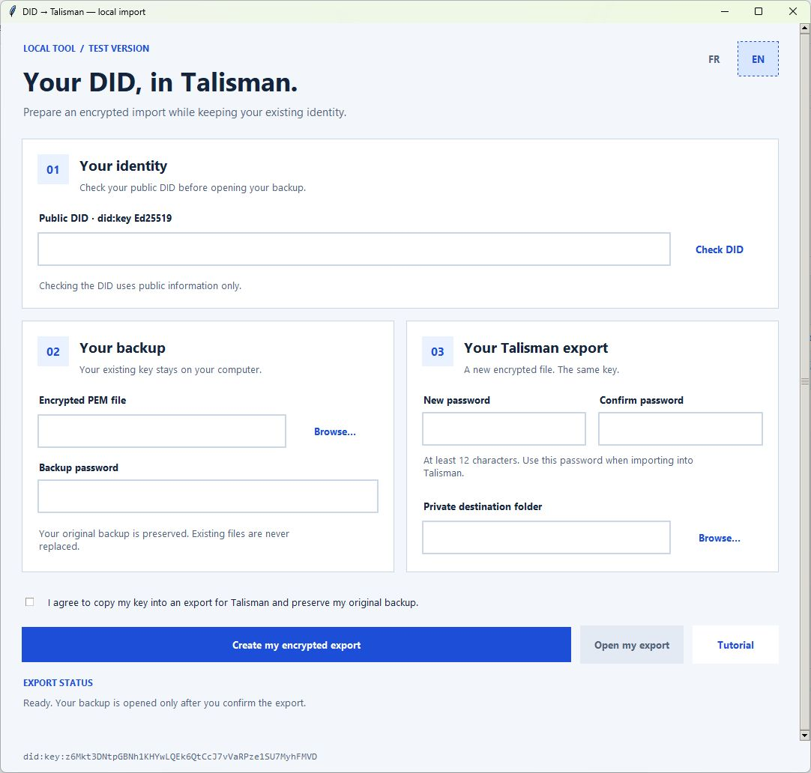

# DID → Talisman

**Public test version 0.1.1 — Windows · English / Français.**

[Download ZIP](https://github.com/AMCONSEIL/did-to-talisman/archive/refs/heads/main.zip) · [Report an issue](https://github.com/AMCONSEIL/did-to-talisman/issues)

**Keep your existing DID and prepare its Talisman import locally.**

[Français](README.fr.md) · [Full tutorial](TUTORIAL.md) · [Attribution](IDENTITY.md)

Convert your **encrypted Ed25519 PEM backup** into an **encrypted Polkadot JSON v3** account for Talisman. The tool checks the key against your DID, restores the export and verifies a signature before confirming success.

## Windows quick start

1. Install [Python 3.11+ with Tcl/Tk](https://www.python.org/downloads/windows/) and [Node.js 22+](https://nodejs.org/en/download).
2. Extract the complete project and run **INSTALLER_WINDOWS.cmd**. Setup downloads locked public dependencies; it reads no wallet.
3. Run **START.cmd** for English or **LANCER.cmd** for French. Enter your DID, select your encrypted backup, choose an export password and private destination, then create the export.

Use the **FR / EN** buttons in the window to switch languages without clearing your inputs.

Conversion works offline after setup. No identity is prefilled and no existing wallet, balance or chain is modified.

**Supported first version: Windows; complete base58btc Ed25519 did:key; encrypted PKCS8 PEM.** Other DID/key methods, pasted seeds, OpenSSH files, hardware/non-exportable wallets and unencrypted PEM are unsupported. A public DID alone cannot recover its key.

Each successful operation creates a new **DID-Talisman-…** folder with:

- **account.json**: encrypted key material for Talisman;
- **verification.public.json**: public identity, SS58 42 address, digest and verification results. No password, seed, login signature or source path.

Original backups and earlier exports are never overwritten. A failed operation may leave an unconfirmed folder: **do not import it**. No automatic deletion.

Importing gives Talisman a copy of your existing identity key. Choose a private local folder outside repositories/shared storage. Windows permissions inherit from that folder; Python/Node do not guarantee physical memory erasure.

Tests: **.\.venv\Scripts\python.exe -m unittest discover -s tests -v**

Tests use **public RFC 8032 fixtures only**, never the author's key. Never use fixtures as real identities or for funds. See [validation](VALIDATION.md).

An independent real Talisman user test is still required before a stable release. This public test version is intended to collect that feedback. FLOP Chat is not yet included. Running setup/conversion neither publishes nor signs a release under the author's DID.

Author: **Julien / AMCONSEIL**
Author DID: **did:key:z6Mkt3DNtpGBNh1KHYwLQEk6QtCcJ7vVaRPze1SU7MyhFMVD**
License: [MIT](LICENSE).

**Signed attribution:** [verifiable personal DID proof](IDENTITY.md), covering version 0.1.1 at commit 8c35ee3. This signature is not a security audit.

## Other systems

The Python/Tk and Node code has no fixed Windows paths. On Linux/macOS, install Python 3.11+ with Tk and Node 22+, create the environment with **python3 -m venv .venv**, run **.venv/bin/python -m pip install --require-hashes --only-binary=:all: -r requirements.lock.txt**, **npm ci --ignore-scripts --no-audit --no-fund**, then **.venv/bin/python did_talisman.py --lang en**. These platforms have not yet been acceptance-tested; .cmd launchers are Windows-only.
