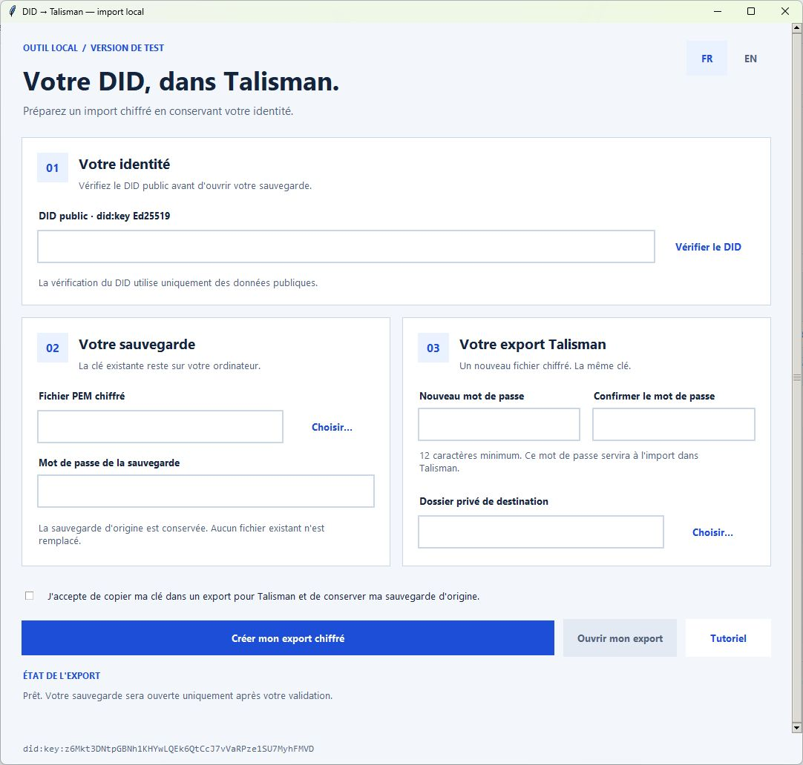

# Utiliser son DID existant dans Talisman

[English](TUTORIAL.md) · [Accueil](README.fr.md)

Auteur : **Julien / AMCONSEIL**
DID d'auteur : **did:key:z6Mkt3DNtpGBNh1KHYwLQEk6QtCcJ7vVaRPze1SU7MyhFMVD**

## 1. Préparer son identité

Avoir **son propre DID public did:key Ed25519**, la **sauvegarde PEM PKCS8 chiffrée de sa clé existante** et son mot de passe. Le DID public seul ne suffit pas.

Si cette identité est déjà disponible dans Talisman et peut signer, aucun nouvel import n'est nécessaire. Pour un autre format de sauvegarde, il faut un adaptateur testé ; renommer le fichier en .pem ne le convertit pas.

Préserver la sauvegarde d'origine. Le DID et sa clé restent identiques, mais Talisman recevra une copie de cette clé. Le logiciel ne génère pas d'identité de remplacement.

## 2. Installer sous Windows

1. Installer [Python 3.11+](https://www.python.org/downloads/windows/) avec son lanceur et le composant **Tcl/Tk**.
2. Installer [Node.js 22+](https://nodejs.org/en/download).
3. Extraire tout le projet, notamment **package-lock.json** et **requirements.lock.txt**, dans un dossier local.
4. Double-cliquer sur **INSTALLER_WINDOWS.cmd**, puis attendre le message de réussite.

L'installation télécharge les dépendances publiques verrouillées de PyPI et npm dans .venv et node_modules. Elle ne demande aucun DID, mot de passe ou wallet. Les bibliothèques ne sont pas installées globalement.

Le script PowerShell est exécuté avec une politique limitée à son processus ; il ne modifie pas la politique système. Équivalent pour un utilisateur technique :
**powershell.exe -NoProfile -ExecutionPolicy Bypass -File .\INSTALLER_WINDOWS.ps1**

Après installation, la conversion peut être effectuée sans connexion Internet.

## 3. Vérifier le DID public

Double-cliquer sur **LANCER.cmd**. Les boutons **FR / EN** dans la fenêtre permettent ensuite de changer de langue sans perdre la saisie.

1. Coller **votre DID public**, pas celui de l'auteur de ce guide.
2. Cliquer sur **Vérifier le DID**.
3. Comparer la clé publique affichée à celle de son identité. L'outil affiche aussi l'adresse Substrate générique **SS58 42**.

Ce bouton ne lit aucune sauvegarde et ne signe rien. Un DID incomplet, d'une autre méthode ou avec un fragment est refusé. Sans accès à sa clé, récupérer cet accès dans l'outil d'origine.

## 4. Créer son export chiffré

1. Dans **Fichier PEM chiffré**, cliquer sur **Choisir…** et sélectionner son propre fichier.
2. Saisir le **mot de passe actuel de la sauvegarde**.
3. Choisir un **nouveau mot de passe d'export d'au moins 12 caractères**, puis le confirmer. Il servira à importer le JSON ; il ne change ni le mot de passe du PEM ni celui de Talisman.
4. Choisir un **dossier privé local**, hors dossier de l'application, dépôt Git et partage public. Conserver le mot de passe séparément du fichier.
5. Cocher l'accord pour la copie locale de la clé.
6. Cliquer sur **Créer mon export chiffré**, puis attendre **Export chiffré vérifié**.

Seul ce clic ouvre la sauvegarde choisie. Le logiciel compare sa clé au DID, crée le JSON chiffré, le restaure en mémoire et vérifie une signature correcte ainsi que le rejet d'un message modifié.

Le nouveau dossier contient **account.json** et **verification.public.json**. Le premier contient une clé chiffrée : **il reste privé**. Le rapport contient seulement des données publiques, mais révèle l'identité ; son partage est facultatif.

Un mauvais mot de passe ou une autre clé provoque un arrêt. En cas d'export non confirmé, **ne pas importer le fichier**. Une erreur peut laisser un nouveau dossier ; un nouvel essai utilise un autre dossier. Aucun export précédent ni sauvegarde source n'est remplacé ou supprimé.

## 5. Importer dans Talisman

1. Installer l'extension depuis [le site officiel Talisman](https://www.talisman.xyz/).
2. Si c'est la première utilisation, configurer son mot de passe de déverrouillage local.
3. Ouvrir **+ / Add account**.
4. Choisir **Import**, puis **JSON file / Import via JSON**.
5. Sélectionner **son propre account.json** créé à l'étape 4.
6. Saisir le **nouveau mot de passe d'export** choisi à cette étape.
7. Sélectionner le compte déverrouillé et terminer l'import.

Les libellés peuvent varier. Le parcours personnel de référence a fonctionné dans Talisman 3.12.0 ; la nouvelle version générique doit encore être suivie par un utilisateur indépendant avant une version stable.

Ne pas choisir **Watch-only** : ce mode peut afficher un compte mais ne peut pas signer. Ne jamais envoyer PEM, JSON de wallet ou mots de passe au site de chat, à GitHub ou au support.

## 6. Vérifier la même identité

Comparer la clé publique du compte importé avec celle du rapport **verification.public.json**. Son adresse utilise le format générique SS58 42.

Une même clé peut apparaître sous des adresses différentes selon le préfixe réseau. Une différence d'affichage ne prouve donc pas une autre identité : la **clé publique doit rester identique**. Si elle diffère, arrêter avant transfert ou connexion.

Le contrôle de restauration de l'outil porte sur le fichier exporté. Une vraie signature de connexion dans l'extension reste nécessaire pour vérifier Talisman.

## 7. Ensuite, se connecter à FLOP

Ce kit ne livre pas encore le chat et ne contacte aucun réseau FLOP.

Quand le client sera disponible : vérifier les paramètres devnet officiels alors en vigueur, connecter Talisman, autoriser uniquement le compte correspondant au DID, relire le challenge officiel puis signer dans l'extension. Vérifier le quota réel, son expiration et les modèles autorisés avant d'envoyer un prompt.

Une signature de connexion n'est pas un transfert. Une transaction inattendue n'appartient pas à ce parcours. Le solde du wallet et le quota API sont distincts ; une reconnexion ne renouvelle pas automatiquement une allocation.

## Dépannage

| Message | Action |
|---|---|
| DID non pris en charge | Utiliser un did:key Ed25519 complet en base58btc, sans fragment. |
| La source doit être un PEM chiffré | Sélectionner la vraie sauvegarde PKCS8 chiffrée ; ne pas renommer un autre format. |
| Impossible de déverrouiller le PEM | Vérifier le mot de passe d'origine, distinct du nouveau mot de passe d'export. |
| La clé ne correspond pas au DID | Retrouver la sauvegarde de cette identité. |
| Installation incomplète | Relancer INSTALLER_WINDOWS.cmd, puis l'application. |
| Export non confirmé | Ne rien importer ; préserver l'original et examiner le dossier de sortie. |
| Adresse apparemment différente | Comparer clé publique et préfixe SS58, sans envoyer de fonds pour tester. |

Pour signaler un problème : donner seulement le code d'erreur et les versions de l'outil, Windows et Talisman. Ne pas joindre les sauvegardes ou mots de passe ; masquer les données personnelles des captures.
